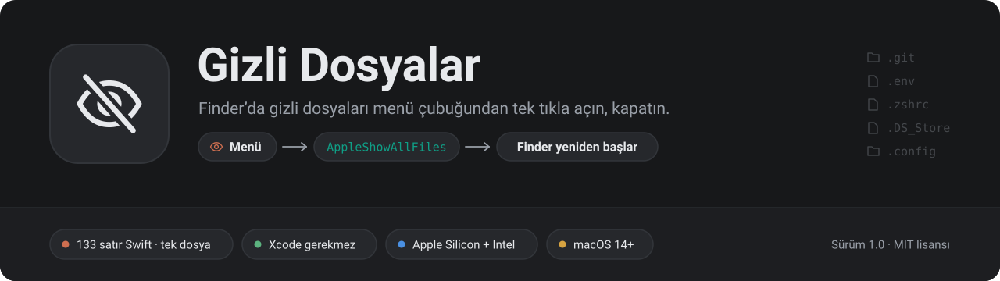
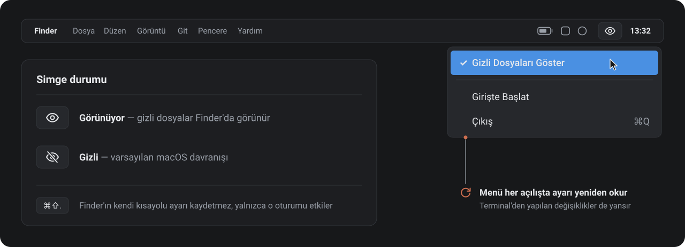
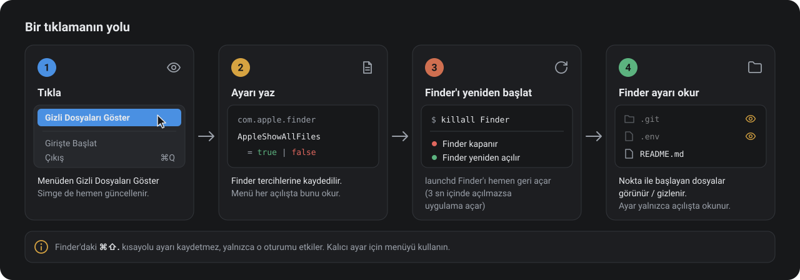

<p align="center"></p>

<p align="center">
  <a href="https://github.com/kralldepo/macos_gizli/releases/latest"></a>
  
  
  
  <a href="LICENSE"></a>
</p>

<p align="center">
  <a href="https://github.com/kralldepo/macos_gizli/releases/latest/download/GizliDosyalar.zip"><b>⬇ GizliDosyalar.zip dosyasını indir</b></a>
</p>

## İçindekiler

- [Hakkında](#hakkında)
- [Kurulum](#kurulum)
- [Kullanım](#kullanım)
- [Nasıl çalışır](#nasıl-çalışır)
- [Bilinmesi gerekenler](#bilinmesi-gerekenler)
- [Kaynaktan derleme](#kaynaktan-derleme)
- [Depo haritası](#depo-haritası)
- [Kaldırma](#kaldırma)
- [Lisans](#lisans)

## Hakkında

macOS, adı nokta ile başlayan dosyaları (`.git`, `.env`, `.zshrc` …) Finder'da gizler. Bu dosyaları görmenin iki yaygın yolu var, ikisi de zahmetli:

- **Finder'da ⌘⇧.** — yalnızca o Finder oturumunu etkiler. Ayar kaydedilmez, Finder yeniden başlayınca kaybolur.
- **Terminal'de** `defaults write com.apple.finder AppleShowAllFiles -bool true && killall Finder` — kalıcıdır ama ezberlenmesi ve her seferinde yazılması gerekir.

**Gizli Dosyalar** bu komutu menü çubuğunda tek bir tıklamaya indirir. Göz simgesi, gizli dosyaların şu an açık mı kapalı mı olduğunu her an gösterir.

**Kimin için:** dotfile düzenleyen geliştiriciler, `.env` ya da `.git` klasörüne Finder'dan ulaşmak isteyenler ve Terminal kullanmadan bu ayarı değiştirmek isteyen herkes.

**Tasarım ilkeleri**

- **Çok basit.** Menüde üç öğe var, penceresi ve Dock simgesi yok.
- **Tek dosya.** Uygulamanın tamamı 133 satırlık bir Swift dosyası, dış bağımlılığı yok.
- **Az yetki.** İnternete bağlanmaz. Finder'da yalnızca `AppleShowAllFiles` ayarına dokunur.
- **Xcode gerekmez.** Command Line Tools ile tek komutla derlenir.

## Kurulum

1. [**GizliDosyalar.zip**](https://github.com/kralldepo/macos_gizli/releases/latest/download/GizliDosyalar.zip) dosyasını indirip çift tıklayarak açın.
2. **Gizli Dosyalar.app**'i **Uygulamalar** klasörüne sürükleyin.
3. Uygulamayı açın. Menü çubuğunda göz simgesi belirir.

> [!IMPORTANT]
> Uygulama ad-hoc olarak imzalanmıştır ve Apple tarafından noter onayından geçirilmemiştir (bunun için ücretli bir Apple Developer hesabı gerekir). Bu nedenle ilk açılışta macOS uygulamanın doğrulanamadığını söyleyip açmayı reddeder. Bir kez izin vermeniz yeterli:
>
> - **Sistem Ayarları › Gizlilik ve Güvenlik** bölümünde sayfanın altına inin ve **Yine de Aç**'a tıklayın, **ya da**
> - Terminal'de karantina işaretini kaldırın:
>
>   ```bash
>   xattr -dr com.apple.quarantine "/Applications/Gizli Dosyalar.app"
>   ```
>
> Kaynak kodu inceleyip uygulamayı [kendiniz derlerseniz](#kaynaktan-derleme) bu uyarıyla hiç karşılaşmazsınız.

Bilgisayar açıldığında otomatik başlaması için menüden **Girişte Başlat**'ı işaretleyin.

## Kullanım

<p align="center"></p>

Simgeye tıklayın ve **Gizli Dosyaları Göster**'i seçin. Yanında onay işareti varsa gizli dosyalar görünür durumdadır. Aynı öğeye tekrar tıklamak onları yeniden gizler.

| Simge | Durum |
|---|---|
| Göz | Gizli dosyalar Finder'da **görünüyor** |
| Üstü çizili göz | Gizli dosyalar **gizli** (macOS'un varsayılanı) |

## Nasıl çalışır

<p align="center"></p>

Finder, `AppleShowAllFiles` ayarını yalnızca açılırken okur. Uygulama ayarı `com.apple.finder` tercihlerine yazar ve Finder'ı `killall Finder` ile kapatır. macOS Finder'ı hemen yeniden açar. Finder 3 saniye içinde geri gelmezse uygulama onu kendisi açar. Menü her açıldığında kayıtlı ayar yeniden okunur; bu sayede ayar Terminal'den değiştirilmiş olsa bile menü doğru durumu gösterir.

## Bilinmesi gerekenler

- **Finder yeniden başlar.** Ayar her değiştiğinde Finder kapanıp yeniden açılır. Finder o sırada dosya kopyalıyorsa kopyalama yarıda kalır.
- **⌘⇧. ile uyuşmazlık.** Finder'daki ⌘⇧. kısayolu ayarı kaydetmez. Bu yüzden kısayolu kullandıktan sonra simge, Finder'ın o anki görünümüyle uyuşmayabilir. Menüden bir tıklama ikisini yeniden eşitler.
- **Test edilen sürüm.** Uygulama macOS 27 (Apple Silicon) üzerinde denendi. macOS 14 ve sonrası için derleniyor.

## Kaynaktan derleme

Gerekenler: macOS 14+ ve Xcode Command Line Tools (`xcode-select --install`).

```bash
git clone https://github.com/kralldepo/macos_gizli.git
cd macos_gizli
./build.sh
open "build/Gizli Dosyalar.app"
```

`build.sh` sırasıyla şunları yapar:

1. Çalışan eski kopyayı kapatır.
2. Uygulamayı Apple Silicon ve Intel için ayrı ayrı derleyip tek bir universal dosyada birleştirir.
3. Uygulama ikonunu çizer.
4. Paketi ad-hoc olarak imzalar.
5. İndirilebilir `build/GizliDosyalar.zip` arşivini hazırlar.

## Depo haritası

```text
Sources/GizliDosyalar.swift   uygulamanın tamamı: menü, Finder ayarı, girişte başlatma
Scripts/ikon.swift            uygulama ikonunu çizer (SF Symbols kullanmadan)
Info.plist                    paket bilgileri: Dock'ta görünmeyen menü çubuğu uygulaması, macOS 14+
build.sh                      derler, ikonu üretir, imzalar, zip'ler
docs/images/                  bu README'nin görselleri
```

## Kaldırma

1. Gizli dosyaları kapalı bırakmak istiyorsanız önce menüden **Gizli Dosyaları Göster**'in işaretini kaldırın. Ayar, uygulama silinse de Finder'da kalır.
2. **Girişte Başlat** işaretliyse işaretini kaldırın.
3. Menüden **Çıkış**'ı seçin ve uygulamayı Çöp Sepeti'ne atın.

Ayarı Terminal'den macOS varsayılanına döndürmek için:

```bash
defaults delete com.apple.finder AppleShowAllFiles; killall Finder
```

## Lisans

[MIT](LICENSE)
